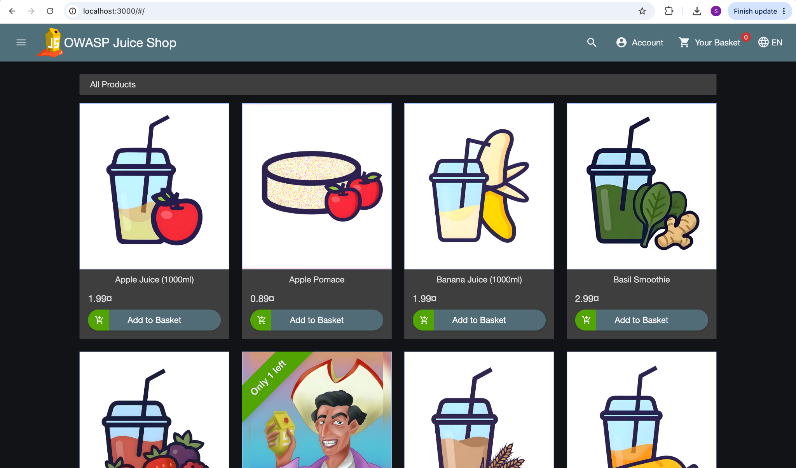
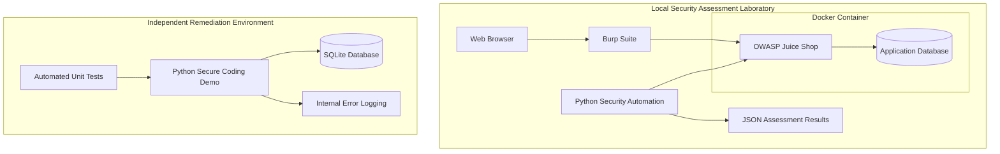
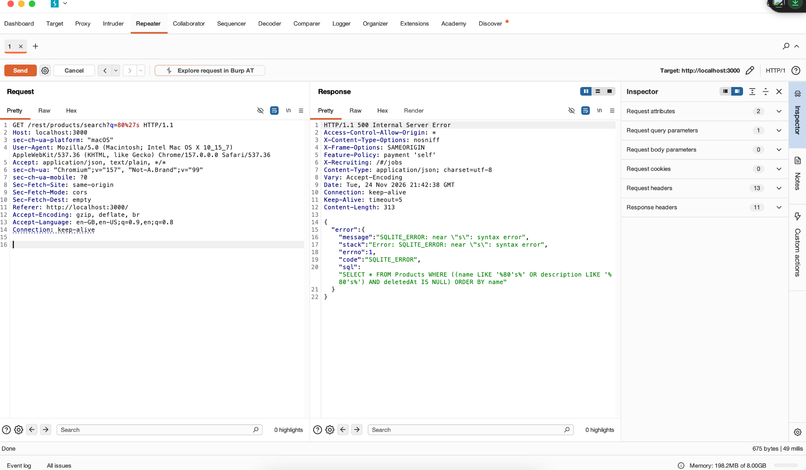
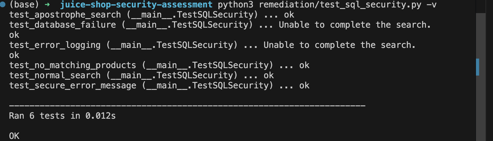
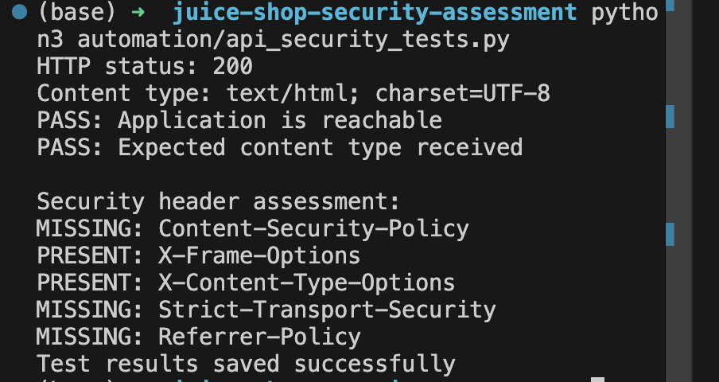
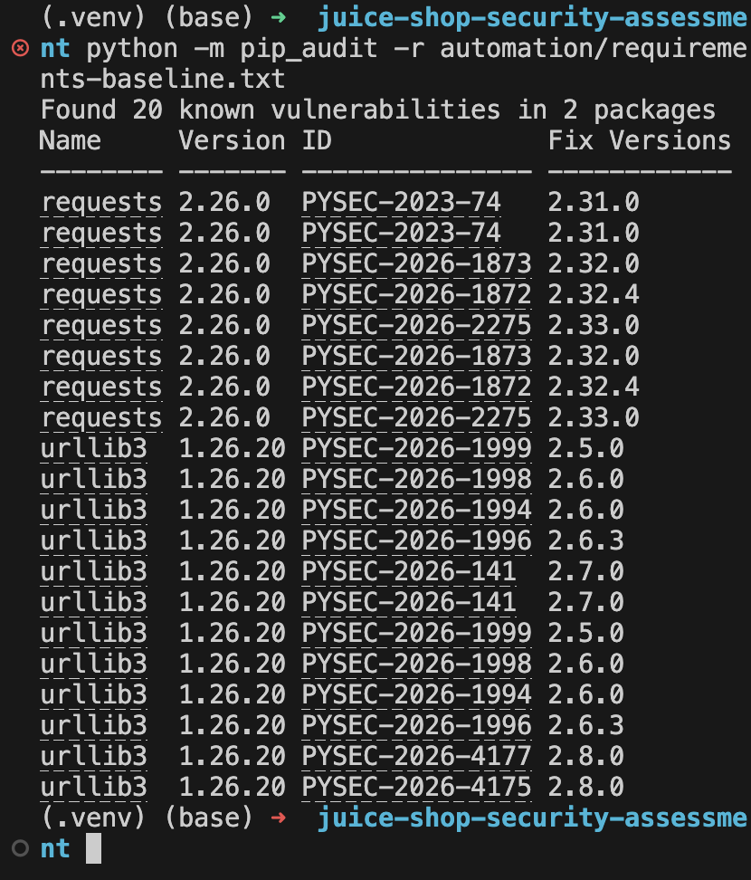
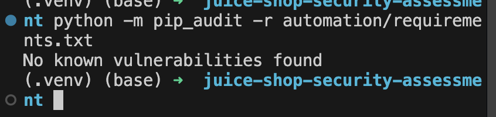

# OWASP Juice Shop — Security Assessment & Remediation

## Project Overview

A practical application security assessment of OWASP Juice Shop, conducted within a controlled local laboratory environment.

This project explores vulnerability identification, security testing, secure coding, automated validation and software dependency security.

The objective was to develop practical security engineering skills by investigating application behaviour, documenting security weaknesses, demonstrating remediation techniques and validating security improvements through automated testing.

*OWASP Juice Shop running locally in a Docker container.*

## Project Highlights

- 33 documented evidence screenshots
- 6 passing automated remediation tests
- Manual web application security assessment
- Python-based HTTP security automation
- Authentication and session management review
- Software dependency vulnerability scanning
- CVSS severity assessment and CWE classification
- Executive and technical security reporting

## Technology Stack

| Technology | Purpose |
|---|---|
| Docker | Containerised laboratory environment |
| OWASP Juice Shop | Application security testing target |
| Burp Suite Community Edition | HTTP traffic inspection and manual testing |
| Python | Security automation and remediation demonstrations |
| SQLite | Secure database query demonstration |
| unittest | Automated remediation testing |
| Requests | HTTP requests and response analysis |
| pip-audit | Software dependency vulnerability scanning |
| JSON | Structured security assessment results |
| Git & GitHub | Version control and portfolio documentation |

## Laboratory Architecture

The assessment was conducted locally using a Docker-hosted instance of OWASP Juice Shop.

### Environment Configuration

- **Containerisation:** Docker and Docker Compose
- **Target application:** OWASP Juice Shop
- **Local endpoint:** http://localhost:3000
- **Network binding:** 127.0.0.1
- **Image versioning:** Immutable SHA-256 image digest
- **Manual assessment:** Burp Suite Community Edition
- **Automated assessment:** Python and Requests
- **Remediation demonstration:** Python and SQLite

The remediation demonstration operates independently of the original Juice Shop application.

The Docker Compose configuration was validated through successful deployment, HTTP regression checks and automated remediation testing.

[View Docker Compose configuration](docker-compose.yml)

## Assessment Methodology

1. Establish a controlled testing environment.
2. Capture and analyse baseline HTTP requests.
3. Investigate unexpected application behaviour.
4. Reproduce and document security findings.
5. Develop secure coding demonstrations.
6. Validate remediation techniques using automated tests.
7. Assess HTTP security headers and CORS configuration.
8. Review authentication and token storage.
9. Scan and update vulnerable Python dependencies.
10. Document findings, severity, recommendations and limitations.

## Security Findings

| ID | Finding | Assessment Status |
|---|---|---|
| F-001 | Unsafe SQL query construction | Strong supporting evidence |
| F-002 | Verbose database error disclosure | Confirmed |
| F-003 | Missing Content Security Policy | Hardening recommendation |
| F-004 | Missing Referrer Policy | Hardening recommendation |
| F-005 | Missing HTTP Strict Transport Security | Not applicable to local HTTP |
| F-006 | Permissive CORS configuration | Potential weakness |
| F-007 | Authentication token stored in local storage | Potential weakness |
| F-008 | Vulnerable Python dependencies | Confirmed by dependency scan |

Findings were evaluated according to observed behaviour and available evidence. Potential weaknesses were not presented as confirmed exploits.

Full details are available in the [Findings Register](reports/findings-register.md) and [Severity Assessment](reports/severity-assessment.md).

## Manual Application Security Testing

Burp Suite was used to inspect HTTP requests and responses, investigate input handling and reproduce unexpected database errors.

The assessment identified verbose database error disclosure and strong evidence of unsafe SQL query construction.

Full SQL injection exploitability was not established during this assessment.

[View detailed security findings](reports/security-findings.md)

## Secure Coding & Remediation

A standalone Python and SQLite demonstration was developed to explore secure database interaction.

The demonstration implements:

- Parameterised SQL queries
- Safe handling of user input
- Database exception handling
- Generic user-facing error messages
- Internal error logging

The demonstration illustrates recommended remediation techniques rather than modifying the original Juice Shop source code.

[View secure coding implementation](remediation/sql_security_demo.py)

[View remediation report](reports/remediation-report.md)

## Automated Remediation Testing

Six automated unit tests were implemented to validate:

- Normal search functionality
- Apostrophe handling
- Searches without matching results
- Database failure handling
- Internal error logging
- Generic user-facing error messages

All six tests passed during the recorded assessment.

[View automated test implementation](remediation/test_sql_security.py)

## HTTP Security Automation

A Python-based assessment script was developed to automate baseline HTTP security checks.

The script evaluates:

- Application availability
- HTTP response status
- Response content type
- Security header presence
- CORS response headers
- Structured JSON result generation
- Graceful handling of connection failures
- Portable JSON output file paths

[View automation script](automation/api_security_tests.py)

[View structured assessment results](automation/test_results.json)

[View automation documentation](automation/README.md)

## Authentication & Session Security

The authentication review examined:

- Login request and response behaviour
- Authentication token storage
- Browser local storage
- Client-side token removal following logout

The assessment identified potential security concerns associated with browser-based token storage.

Server-side token invalidation and token expiry were outside the validated scope.

[View authentication assessment](reports/authentication-assessment.md)

## Software Dependency Security

Software composition analysis was conducted using pip-audit to identify known vulnerabilities in the Python automation dependencies.

| Assessment Stage | Result |
|---|---|
| Baseline dependency scan | Known vulnerabilities identified |
| Updated dependency scan | No known vulnerabilities reported |
| Post-update regression testing | Baseline HTTP checks passed |

### Before Dependency Updates

### After Dependency Updates

The updated scan reflects known vulnerabilities reported at the time of assessment and does not guarantee the absence of all security risks.

[View dependency assessment](reports/dependency-assessment.md)

## Security Assessment Reports

| Report | Description |
|---|---|
| [Final Assessment Report](reports/final-assessment.pdf) | Consolidated security assessment |
| [Executive Summary](reports/executive-summary.md) | High-level findings and recommendations |
| [Security Findings](reports/security-findings.md) | Technical application security findings |
| [Findings Register](reports/findings-register.md) | Consolidated findings and assessment status |
| [Severity Assessment](reports/severity-assessment.md) | Vulnerability severity evaluation |
| [Vulnerability Classification](reports/vulnerability-classification.md) | CWE and OWASP vulnerability mapping |
| [Remediation Report](reports/remediation-report.md) | Secure coding and validation |
| [Authentication Assessment](reports/authentication-assessment.md) | Authentication and token storage review |
| [Dependency Assessment](reports/dependency-assessment.md) | Software composition analysis |

## Repository Structure

    juice-shop-security-assessment/
    ├── automation/
    │   ├── api_security_tests.py
    │   ├── requirements.txt
    │   ├── requirements-baseline.txt
    │   ├── test_results.json
    │   └── README.md
    ├── evidence/
    ├── remediation/
    │   ├── sql_security_demo.py
    │   └── test_sql_security.py
    ├── reports/
    ├── .gitignore
    ├── docker-compose.yml
    └── README.md

## Getting Started

### Prerequisites

- Docker Desktop or Docker Engine with Docker Compose
- Python 3.14 (tested with Python 3.14.6)
- Git
- Burp Suite Community Edition (optional, for manual assessment)

### 1. Start the Laboratory

From the project root, run:

    docker compose up -d

Verify the container is running:

    docker compose ps

Open the application at http://localhost:3000.

The Docker image is pinned using a SHA-256 digest to support reproducibility. The application is bound to the loopback interface to restrict network exposure.

### 2. Create a Python Virtual Environment

    python3 -m venv .venv
    source .venv/bin/activate

### 3. Install Dependencies

    python -m pip install -r automation/requirements.txt

The baseline requirements file is retained for historical audit comparison only and should not be used for installation.

### 4. Run the Automated Remediation Tests

    python -m unittest discover -s remediation -v

Expected result: six passing unit tests.

### 5. Run the HTTP Security Assessment

    python automation/api_security_tests.py

Structured assessment results are saved to automation/test_results.json.

### 6. Stop the Laboratory

    docker compose stop

### Validation

The Docker Compose environment was successfully deployed and validated through application availability checks, HTTP regression testing and six passing standalone remediation tests.

Connection failure handling was also validated by deliberately stopping the target application and confirming that the automation script returned a generic error message and a non-zero exit code without exposing a Python traceback.

### Security Notice

OWASP Juice Shop is intentionally vulnerable. This laboratory is intended for local educational use only and should not be exposed to public networks.

## Key Learning Outcomes

- Understanding HTTP requests and responses
- Investigating application input handling
- Distinguishing confirmed vulnerabilities from potential weaknesses
- Applying parameterised SQL queries
- Implementing secure exception handling
- Developing automated security tests
- Assessing browser security controls
- Identifying and updating vulnerable dependencies
- Communicating technical findings and remediation recommendations

## Scope & Ethical Considerations

All application security testing was conducted against a locally hosted, intentionally vulnerable application designed for security education.

This project is intended for educational and professional portfolio purposes. It does not involve testing unauthorised systems or production applications.

## Acknowledgements

OWASP Juice Shop is an open-source, intentionally vulnerable web application maintained by the OWASP community.

Official project: https://owasp.org/www-project-juice-shop/

This repository documents my assessment, remediation demonstrations, automation and security reporting rather than the development of OWASP Juice Shop itself.

## Author

Sulekha S.

Software Engineering | Cybersecurity | Security Automation
